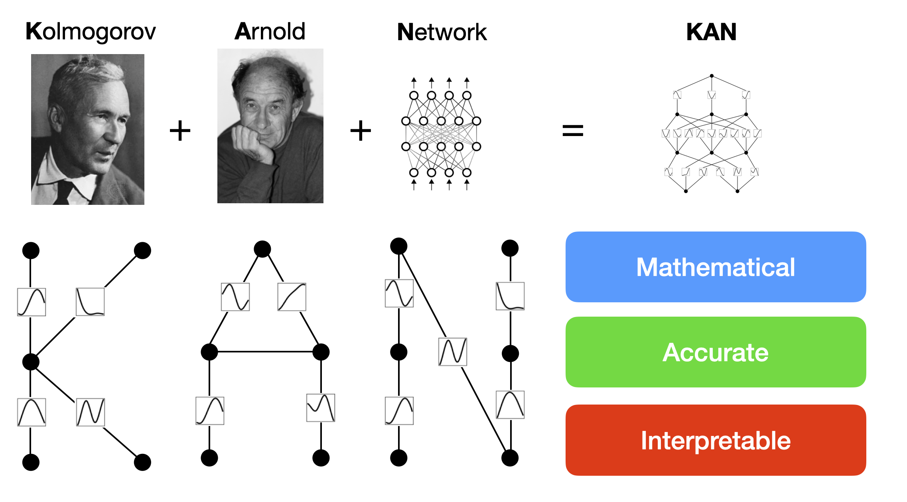

xKAN: Kolmogorov-Arnold Networks, up to date
=============================================

xKAN continues `pykan <https://github.com/KindXiaoming/pykan>`_, the code Ziming Liu and colleagues wrote for
`KAN: Kolmogorov-Arnold Networks <https://arxiv.org/abs/2404.19756>`_ and
`KAN 2.0: Kolmogorov-Arnold Networks Meet Science <https://arxiv.org/abs/2408.10205>`_. pykan's last release, 0.2.8,
dates from November 2024 and its last commit from January 2025. Other projects (efficient-KAN, FastKAN, FasterKAN,
Deep-KAN, ChebyKAN, KANLib) improved single parts of it. xKAN fixes pykan, moves it to current Python and PyTorch, and
combines those improvements with pykan's interpretability tools: pruning, attribution, symbolic regression, formulas
and plots.

Kolmogorov-Arnold networks put learnable univariate functions on the edges of a network, where a multilayer
perceptron has fixed activations on its nodes. You can prune a trained network, replace its edge functions with
symbolic ones and read the whole network as a formula.

Installation
------------

xKAN needs Python 3.12 or later and PyTorch 2.14 or later. It is not on PyPI yet; install it from GitHub::

   pip install "xkan @ git+https://github.com/khazum/xkan"           # the core: torch, numpy, sympy
   pip install "xkan[plot] @ git+https://github.com/khazum/xkan"     # adds matplotlib, for xkan.viz
   pip install "xkan[contrib] @ git+https://github.com/khazum/xkan"  # adds the MLP baseline, Feynman datasets and hypothesis tests

From a clone: ``pip install -e ".[dev]"``. If you come from pykan, read :doc:`migration`.

.. toctree::
   :maxdepth: 1
   :caption: Getting started

   _notebooks/hellokan
   migration
   changelog

.. toctree::
   :maxdepth: 2
   :caption: Tutorials

   demos
   interp
   examples
   physics
   community

.. toctree::
   :maxdepth: 2
   :caption: Reference

   api
